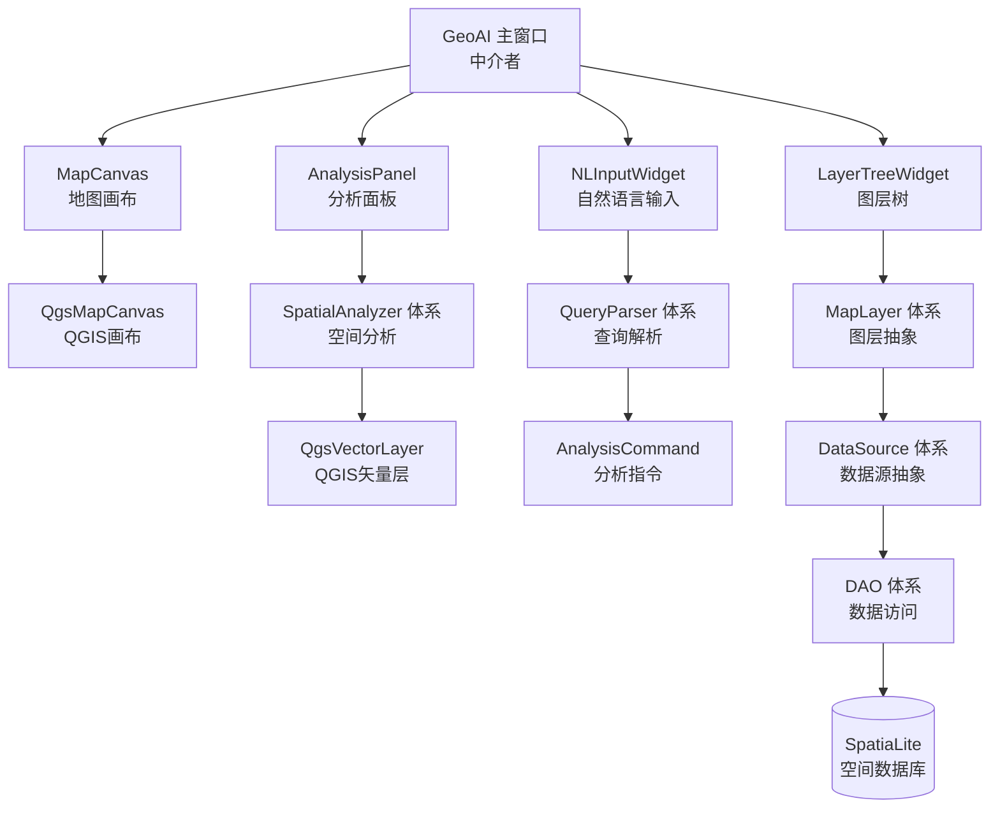
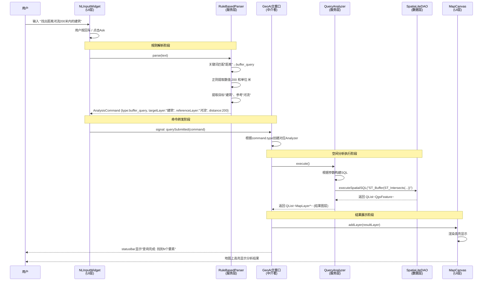
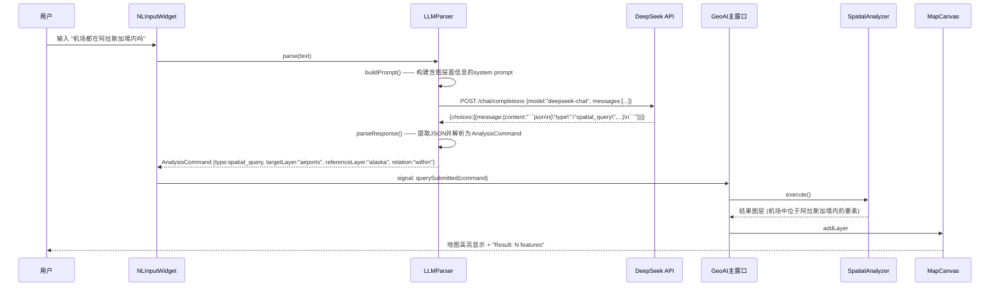
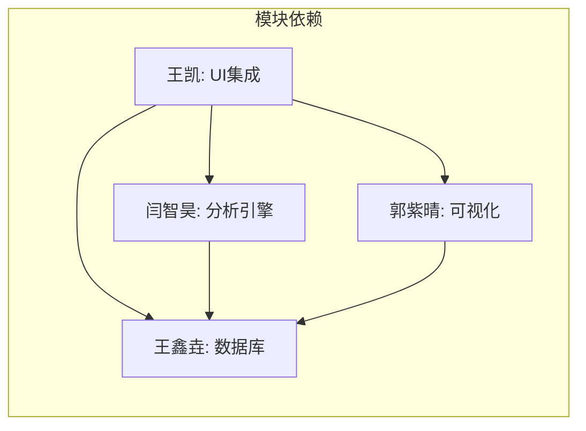

# GeoAI — AI增强智能空间分析平台 设计文档

**课程：** 面向对象程序设计  
**项目：** GeoAI — AI-Enhanced Spatial Analysis Platform  
**版本：** 1.0  
**日期：** 2026-06-01  

---

## 1. 系统架构说明

### 1.1 总体架构图

系统采用**逻辑分层 C/S 架构**，在单进程内通过抽象接口实现各层解耦：

```
┌─────────────────────────────────────────────────────────────┐
│                    UI 层 (ui/)                               │
│  MapCanvas · LayerTreeWidget · AnalysisPanel · NLInputWidget │
├─────────────────────────────────────────────────────────────┤
│                   服务层 (analysis/ + nlp/)                   │
│  SpatialAnalyzer 体系 · QueryParser 体系 · AnalysisCommand   │
├─────────────────────────────────────────────────────────────┤
│                   数据层 (core/ + SQL/)                     │
│  MapLayer 体系 · DataSource 体系 · DAO 体系 · Renderer 体系  │
└─────────────────────────────────────────────────────────────┘
```

**分层职责：**
- **UI层：** 负责用户交互，数据可视化，参数输入与结果展示。所有UI组件通过信号-槽与主窗口通信，不直接调用服务层。
- **服务层：** 负责业务逻辑，包括空间分析算法的执行和自然语言查询的解析。通过抽象接口与上下层解耦。
- **数据层：** 负责数据抽象与持久化。提供统一的图层抽象、数据源抽象和数据库访问接口。

### 1.2 模块关系图



### 1.3 技术选型说明

| 技术组件 | 选择 | 理由 |
|---------|------|------|
| GUI框架 | Qt 5.15 (Widgets) | 与QGIS原生集成，丰富的UI组件库，信号-槽机制天然适合组件解耦 |
| GIS引擎 | QGIS 3.14 (C++ API) | 成熟的空间数据读写、渲染、分析能力，提供QgsMapCanvas等开箱即用的GIS控件 |
| 空间数据库 | SpatiaLite | 文件型数据库，零配置，基于SQLite，适合桌面级GIS应用，开箱即用 |
| 语言标准 | C++17 | 智能指针(std::unique_ptr)、optional、string_view等现代特性，提升代码安全性与可读性 |
| 构建工具 | Visual Studio 2022 + MSBuild | 开发环境已配置Qt VS Tools，与Windows平台深度集成 |
| LLM接入 | DeepSeek Chat API (HTTP REST) | 性价比高，兼容OpenAI接口格式，通过Qt Network / urllib实现HTTP调用 |
| 源码管理 | Git (本地) | 版本控制与协作基础 |

---

## 2. UML 建模

### 2.1 核心类图

```mermaid
classDiagram
    class MapLayer {
        <<abstract>>
        # QString mName
        # QString mId
        # bool mVisible
        # unique_ptr~Renderer~ mRenderer
        # unique_ptr~DataSource~ mDataSource
        +load()* bool
        +unload()* void
        +extent()* QgsRectangle
        +setRenderer(Renderer*)
        +renderer() Renderer*
        +setDataSource(DataSource*)
        +qgsMapLayer()* QgsMapLayer*
    }
    
    class VectorLayer {
        - QgsVectorLayer* mQgsLayer
        - QString mGeometryType
        +load() bool
        +unload() void
        +isValid() bool
        +featureCount() int
        +geometryType() GeometryType
        +qgsVectorLayer() QgsVectorLayer*
    }
    
    class RasterLayer {
        - QgsRasterLayer* mQgsLayer
        - bool mGrayStretch
        +load() bool
        +unload() void
        +bandCount() int
        +setGrayStretch(bool)
        +setColorRamp(QList~QColor~)
    }
    
    class Renderer {
        <<abstract>>
        +applyToVectorLayer(QgsVectorLayer*)* void
        +applyToRasterLayer(QgsRasterLayer*)* void
        +rendererType()* RendererType
        +clone()* unique_ptr~Renderer~
    }
    
    class SimpleRenderer {
        - QColor mFillColor
        - QColor mStrokeColor
        - double mLineWidth
        - double mPointSize
        +applyToVectorLayer(QgsVectorLayer*) void
    }
    
    class ClassifiedRenderer {
        - QString mFieldName
        - QMap~QString,QColor~ mColorMap
        +autoClassify(QgsVectorLayer*, QString) void
        +addClassValue(QString, QColor) void
    }
    
    class GraduatedRenderer {
        - QString mFieldName
        - int mClassCount
        - ClassificationMode mMode
        +autoClassify(QgsVectorLayer*, QString) void
    }
    
    class DataSource {
        <<abstract>>
        # QString mUri
        +connect()* bool
        +disconnect()* void
        +isConnected()* bool
    }
    
    class FileDataSource {
        - QString mFilePath
        +connect() bool
    }
    
    class DatabaseDataSource {
        - QString mConnectionName
        +connect() bool
    }
    
    MapLayer <|-- VectorLayer : 继承
    MapLayer <|-- RasterLayer : 继承
    MapLayer o-- Renderer : 策略组合
    Renderer <|-- SimpleRenderer : 继承
    Renderer <|-- ClassifiedRenderer : 继承
    Renderer <|-- GraduatedRenderer : 继承
    MapLayer o-- DataSource : 组合
    DataSource <|-- FileDataSource : 继承
    DataSource <|-- DatabaseDataSource : 继承
    
    class DataAccessObject {
        <<abstract>>
        +connect(string)* bool
        +disconnect()* void
        +readFeatures(layerName)* QList~QgsFeature~
        +writeFeatures(layerName, features)* bool
        +executeSpatialSQL(sql)* QList~QgsFeature~
        +buffer(layerName, distance)* QList~QgsFeature~
        +intersect(layerA, layerB)* QList~QgsFeature~
        +create(type)* static DataAccessObject*  (factory)
    }
    
    class SpatiaLiteDAO {
        - QSqlDatabase mDb
        +connect(dbPath) bool
        +readFeatures(layerName) QList~QgsFeature~
        +buffer(layerName, distance) QList~QgsFeature~
        +intersect(layerA, layerB) QList~QgsFeature~
    }
    
    DataAccessObject <|-- SpatiaLiteDAO : 继承
    DataAccessObject <.. SpatiaLiteDAO : 工厂创建
    
    class SpatialAnalyzer {
        <<abstract>>
        # unique_ptr~AnalysisParam~ mParams
        # QList~MapLayer*~ mInputLayers
        +execute()* QList~MapLayer*~
        +setParameters(Params*) void
        +setInputLayers(Layers) void
    }
    
    class AnalysisParam {
        <<abstract>>
        +typeName()* QString
    }
    
    class BufferParam {
        + QString targetLayerId
        + double distance
        + int segments
        + bool dissolve
    }
    
    class OverlayParam {
        + QString layerAId
        + QString layerBId
        + OverlayOp operation
    }
    
    class QueryParam {
        + QString layerId
        + QString attributeFilter
        + QgsRectangle spatialExtent
        + double bufferDistance
    }
    
    class BufferAnalyzer {
        +execute() QList~MapLayer*~
        +description() QString
    }
    
    class OverlayAnalyzer {
        +execute() QList~MapLayer*~
        +description() QString
    }
    
    class QueryAnalyzer {
        +execute() QList~MapLayer*~
        +description() QString
    }
    
    SpatialAnalyzer <|-- BufferAnalyzer : 策略继承
    SpatialAnalyzer <|-- OverlayAnalyzer : 策略继承
    SpatialAnalyzer <|-- QueryAnalyzer : 策略继承
    SpatialAnalyzer o-- AnalysisParam : 组合
    AnalysisParam <|-- BufferParam : 继承
    AnalysisParam <|-- OverlayParam : 继承
    AnalysisParam <|-- QueryParam : 继承
    
    class QueryParser {
        <<abstract>>
        +parse(text)* AnalysisCommand
        +parserName()* QString
        +create(type)* static unique_ptr~QueryParser~  (factory)
    }
    
    class RuleBasedParser {
        - QMap~QString,QString~ mKeywordDict
        +parse(text) AnalysisCommand
        +canParse(text) bool
    }
    
    class LLMParser {
        - QString mApiEndpoint
        - QString mApiKey
        - QString mModel
        - QString mLastReply
        +parse(text) AnalysisCommand
        +setApiKey(key) void
        +explainResults(query, result) QString
    }
    
    class AnalysisCommand {
        + AnalysisType type
        + QString targetLayer
        + QString referenceLayer
        + double distance
        + QString attributeFilter
        + SpatialRelation relation
        + toJson() QJsonObject
        + fromJson(json) AnalysisCommand
        + isValid() bool
    }
    
    QueryParser <|-- RuleBasedParser : 策略继承
    QueryParser <|-- LLMParser : 策略继承
    QueryParser ..> AnalysisCommand : 创建
    
    class GeoAI {
        - unique_ptr~LayerManager~ mLayerManager
        - unique_ptr~QueryParser~ mQueryParser
        - MapCanvas* mMapCanvas
        - LayerTreeWidget* mLayerTree
        - AnalysisPanel* mAnalysisPanel
        - NLInputWidget* mNLInput
        +onNaturalLanguageQuery(cmd) void
        +onExecuteAnalysis() void
        +onLoadVectorData() void
        +onSetSimpleRenderer() void
        +setupConnections() void
    }
    
    GeoAI o-- MapCanvas : 中介者组合
    GeoAI o-- LayerTreeWidget : 中介者组合
    GeoAI o-- AnalysisPanel : 中介者组合
    GeoAI o-- NLInputWidget : 中介者组合
    GeoAI --> SpatialAnalyzer : 调用
    GeoAI --> QueryParser : 调用
```



### 2.2 时序图：自然语言查询 → 解析 → 分析 → 结果展示

以下时序图展示用户输入"找出距离河流200米内的建筑"的完整交互流程：

#### 流程A：规则解析路径



#### 流程B：大模型解析路径

当用户勾选"AI"模式时，`LLMParser` 替代 `RuleBasedParser`：



---

## 3. 面向对象设计说明

### 3.1 使用的设计模式

| 设计模式 | 应用位置 | 核心类 | 解决的问题 |
|---------|---------|--------|-----------|
| **策略模式** | 渲染器体系 | `Renderer` 基类 → `SimpleRenderer` / `ClassifiedRenderer` / `GraduatedRenderer` | 渲染算法可独立于`MapLayer`变化，新增渲染方式只需增加派生类，无需修改图层代码 |
| **策略模式** | 空间分析体系 | `SpatialAnalyzer` 基类 → `BufferAnalyzer` / `OverlayAnalyzer` / `QueryAnalyzer` | 分析算法可互换，UI层只依赖抽象接口，新增分析类型不修改已有代码 |
| **策略模式** | 查询解析体系 | `QueryParser` 接口 → `RuleBasedParser` / `LLMParser` | 解析算法可切换（规则 vs AI），共用`AnalysisCommand`输出，互不影响 |
| **工厂模式** | DAO创建 | `DataAccessObject::create(type)` 静态工厂 | 将DAO对象的创建与使用解耦，通过类型参数切换具体数据库实现 |
| **模板方法** | 图层生命周期 | `MapLayer::load()` / `unload()` | 定义"加载-显示-查询-卸载"的骨架，子类实现具体流程步骤 |
| **中介者模式** | 主窗口协调 | `GeoAI` 主窗口 | UI组件间不直接通信，全部通过主窗口的信号-槽连接协调，降低组件耦合度 |
| **命令模式** | 分析指令封装 | `AnalysisCommand` | 将NL解析结果封装为可执行、可序列化、可传输的命令对象，实现解析与执行分离 |
| **适配器模式** | 数据源封装 | `DataSource` 基类 | 将QGIS多样化的数据源API（文件、数据库、WMS等）适配为统一接口 |
| **单例模式** | 图层管理器 | `scr/LayerManager` | 全局唯一管理所有已加载图层，各模块通过统一入口访问图层 |

### 3.2 抽象层次设计思路

**为什么这样划分基类和派生类？**

#### (1) MapLayer → VectorLayer / RasterLayer

```
MapLayer (抽象基类)
├── VectorLayer  — 点/线/面矢量数据
└── RasterLayer  — 栅格格网数据
```

**设计理由：** 矢量与栅格在数据结构（点坐标序列 vs 像素矩阵）、渲染方式（符号化 vs 色带拉伸）、分析算法（缓冲区 vs 重分类）上完全不同。但两者共享"加载-显示-查询-卸载"的生命周期，以及名称、可见性、数据源等公共属性。基类抽取共性，子类封装差异，上层代码通过多态统一处理所有图层类型。

#### (2) Renderer → SimpleRenderer / ClassifiedRenderer / GraduatedRenderer / RasterColorRampRenderer

```
Renderer (抽象基类: 策略)
├── SimpleRenderer        — 单色填充
├── ClassifiedRenderer    — 按属性值分类着色
├── GraduatedRenderer     — 按数值场分级渐变色
└── RasterColorRampRenderer — 栅格色带
```

**设计理由：** 渲染本质是"将数据映射为视觉符号"的算法。不同渲染策略可互换且可动态切换——同一图层可在简单渲染和分类渲染之间切换。图层持有`Renderer*`指针并委托渲染，符合策略模式核心思想：算法独立于客户端。新增渲染方式（如热力图）只需增加派生类。

#### (3) SpatialAnalyzer → BufferAnalyzer / OverlayAnalyzer / QueryAnalyzer

```
SpatialAnalyzer (抽象基类: 策略)
├── BufferAnalyzer     — 缓冲区分析
├── OverlayAnalyzer    — 叠加分析(交集/并集)
└── QueryAnalyzer      — 属性/空间查询
```

**设计理由：** 空间分析是系统的核心功能，不同分析算法共享"输入参数 → 执行计算 → 输出结果图层"的流程。通过策略模式，UI层只需选择合适的Analyzer并调用`execute()`，无需关心具体算法实现。分析参数（距离、操作类型、过滤条件）封装为独立的`AnalysisParam`类层次，与Analyzer解耦。

#### (4) DataAccessObject → SpatiaLiteDAO

```
DataAccessObject (抽象基类: 接口)
└── SpatiaLiteDAO — SpatiaLite实现
    （预留 PostGISDAO、GeoPackageDAO 扩展点）
```

**设计理由：** 数据库方言不同（SQLite vs PostgreSQL）但操作语义相同（读取、写入、空间查询）。上层分析引擎只依赖`DataAccessObject`抽象接口，可无缝切换数据库后端。工厂方法`create(type)`屏蔽具体创建细节。

#### (5) QueryParser → RuleBasedParser / LLMParser

```
QueryParser (抽象接口: 策略)
├── RuleBasedParser  — 关键词+正则匹配（必做）
└── LLMParser        — 大模型语义理解（加分项）
```

**设计理由：** 自然语言解析有多种实现方式。`RuleBasedParser`通过关键词词典和正则表达式快速解析结构化查询；`LLMParser`调用DeepSeek API实现复杂语义理解。两者完全共用`AnalysisCommand`输出格式，上层代码无需修改即可切换解析策略。

### 3.3 接口设计考量（层间解耦）

```
┌─ UI 层 ─────────────────────────────────────┐
│  依赖抽象接口，不依赖具体实现                   │
│                                               │
│  UI层 ──依赖──> LayerManager (图层访问抽象)     │
│  UI层 ──依赖──> SpatialAnalyzer* (分析器抽象)   │
│  UI层 ──依赖──> QueryParser* (解析器抽象)       │
└──────────────────────┬───────────────────────┘
                       │ 依赖注入
┌─ 服务层 ─────────────┴───────────────────────┐
│  QueryParser → AnalysisCommand → SpatialAnalyzer │
│                                               │
│  服务层 ──依赖──> IDataAccessObject (DAO抽象)   │
└──────────────────────┬───────────────────────┘
                       │ 依赖注入
┌─ 数据层 ─────────────┴───────────────────────┐
│  SpatiaLiteDAO (DAO具体实现)                   │
│  MapLayer/VectorLayer/RasterLayer (图层实现)    │
└──────────────────────────────────────────────┘
```

**具体解耦方式：**

1. **UI层 ⇢ 服务层：** `GeoAI`主窗口持有`QueryParser*`和`SpatialAnalyzer*`指针（实际为`unique_ptr`），通过构造函数或setter注入具体实现。UI只调用`parse()`和`execute()`接口，不关心底层是规则解析还是LLM解析。

2. **服务层 ⇢ 数据层：** `SpatialAnalyzer`的派生类通过`DataAccessObject*`接口访问数据库，由`GeoAI::initModules()`在初始化时将具体DAO实例注入分析器。

3. **层间数据传输：** `AnalysisCommand`作为统一的数据传输对象(DTO)，承担了解析结果从NL模块到分析模块的传递职责，同时支持JSON序列化/反序列化，便于调试和持久化。

4. **信号-槽机制：** UI组件间不直接调用方法，而是通过Qt信号-槽机制通信。例如`NLInputWidget::querySubmitted`信号连接到`GeoAI::onNaturalLanguageQuery`槽，由主窗口协调后续流程。

---

## 4. 分工与贡献说明

### 4.1 团队成员及分工

| 成员 | 角色 | 负责模块 | 具体工作内容 |
|------|------|---------|-------------|
| **闫智昊** | 组长 | 空间分析引擎 + 自然语言查询 | — SpatialAnalyzer抽象基类与策略体系设计<br>— BufferAnalyzer / OverlayAnalyzer / QueryAnalyzer 实现<br>— AnalysisCommand 命令封装与JSON序列化<br>— QueryParser抽象接口 + RuleBasedParser规则解析器<br>— LLMParser大模型API集成与Prompt工程<br>— 几何算法库(GeometryAlgorithm)：缓冲区、交并差计算 |
| **郭紫晴** | 组员 | 地图可视化 | — MapLayer抽象基类设计（模板方法模式）<br>— VectorLayer / RasterLayer 派生类实现<br>— Renderer策略体系：SimpleRenderer / ClassifiedRenderer / GraduatedRenderer<br>— MapCanvas封装（QgsMapCanvas缩放/平移/全图）<br>— LayerTreeWidget图层树控件<br>— OverviewMap鹰眼图控件<br>— 自建Geometry几何类型(Point/LineString/Polygon/Envelope) |
| **王鑫垚** | 组员 | 数据访问层 | — DataAccessObject抽象接口设计（增删查改+空间SQL）<br>— SpatiaLiteDAO具体实现（Qt QSqlDatabase）<br>— SpatialQuery空间SQL构造器(ST_Buffer/ST_Intersects/ST_Within)<br>— 空间数据库连接管理与RAII资源释放<br>— SqlHelper数据库辅助工具 |
| **王凯** | 组员 | UI集成 + QGIS插件 | — GeoAI主窗口（中介者模式）实现<br>— AnalysisPanel分析参数面板<br>— AttributeTableWidget属性表控件<br>— NLInputWidget自然语言输入控件<br>— 工具栏/菜单栏/状态栏搭建<br>— QGIS插件注册（metadata.txt + __init__.py）<br>— 插件构建与安装脚本(install_plugin.bat)<br>— 文件拖拽加载、工程保存/读取 |

### 4.2 团队协作方式

| 协作方面 | 具体方式 |
|---------|---------|
| **沟通工具** | QQ群日常沟通，重要决策群内讨论确认 |
| **代码管理** | Git本地版本控制，组长定期合并各成员代码 |
| **接口协商** | 模块间接口（如DAO抽象、AnalysisCommand格式）由组长统一制定，各成员按接口文档实现 |
| **集成测试** | 组长负责将各模块代码集成到主工程，统一调试 |
| **问题追踪** | 通过QQ群报告bug，实时修复 |

### 4.3 各模块接口依赖关系



---

## 5. 文件结构总览

```
GeoAI/
├── main.cpp                          # 应用入口（初始化QGIS应用）
├── GeoAI.h / .cpp / .ui              # 主窗口（中介者模式）
├── GeoAI.qrc                         # Qt资源文件
├── GeoAI.sln / .vcxproj              # Visual Studio 2022 工程
├── Design.md                         # 本设计文档
├── README.md                         # 编译运行说明
├── run.bat                           # 启动脚本（配置QGIS运行环境）
├── .gitignore                        # Git忽略规则
│
├── scr/                              # 简化图层几何层（模块间接口对齐）
│   ├── MapLayer.h                    #   图层抽象基类（简化版）
│   ├── VectorLayer.h / .cpp          #   矢量图层接口+实现
│   ├── RasterLayer.h                 #   栅格图层接口
│   ├── LayerManager.h                #   图层管理器单例
│   ├── LayerManagerWidget.h / .cpp   #   图层管理UI控件
│   ├── Geometry.h                    #   自建几何类型(Point/LineString/Polygon/Envelope)
│   ├── GeometryAlgorithm.h / .cpp    #   几何算法(缓冲区/交并差)
│   ├── test_geometry.cpp             #   几何算法测试
│   └── test_vectorlayer.cpp          #   矢量图层测试
│
├── core/                             # 核心抽象层（正式版）
│   ├── MapLayer.h / .cpp             #   图层抽象基类 + VectorLayer, RasterLayer
│   ├── DataSource.h / .cpp           #   数据源抽象 + FileDataSource, DatabaseDataSource
│   ├── Renderer.h / .cpp             #   渲染器策略体系（5种渲染器）
│   ├── AnalysisCommand.h / .cpp      #   结构化分析指令（命令模式）
│   └── LayerManager.h / .cpp         #   图层管理器
│
├── SQL/                              # 数据访问层
│   ├── DataAccessObject.h / .cpp     #   DAO 抽象接口（含工厂方法）
│   ├── SpatiaLiteDAO.h / .cpp        #   SpatiaLite 实现
│   ├── SpatialQuery.h / .cpp         #   空间SQL构造器
│   └── SqlHelper.h                   #   SQL辅助工具
│
├── analysis/                         # 空间分析引擎
│   ├── SpatialAnalyzer.h / .cpp      #   分析器抽象基类
│   ├── AnalysisParam.h               #   参数类层次（Buffer/Overlay/Query）
│   ├── Analyzers.h / .cpp            #   分析器具体实现
│   ├── BufferAnalyzer.h / .cpp       #   缓冲区分析
│   ├── OverlayAnalyzer.h / .cpp      #   叠加分析
│   └── QueryAnalyzer.h / .cpp        #   属性/空间查询
│
├── nlp/                              # 自然语言处理
│   ├── QueryParser.h / .cpp          #   解析器抽象接口 + 工厂方法
│   ├── RuleBasedParser.h / .cpp      #   规则解析器（关键词+正则）
│   └── LLMParser.h / .cpp            #   大模型解析器（DeepSeek API）
│
├── ui/                               # UI 组件
│   ├── MapCanvas.h / .cpp            #   QGIS地图画布封装
│   ├── LayerTreeWidget.h / .cpp      #   图层树控件
│   ├── AnalysisPanel.h / .cpp        #   分析参数面板
│   ├── NLInputWidget.h / .cpp        #   自然语言输入控件
│   ├── AttributeTableWidget.h / .cpp #   属性表控件
│   └── OverviewMap.h / .cpp          #   鹰眼图控件
│
├── plugin/                           # QGIS插件（Python）
│   ├── __init__.py                   #   插件入口
│   ├── geoai_plugin.py              #   插件主类 + 面板（含LLM调用）
│   └── metadata.txt                  #   插件元数据
│
├── data/                             # 示例数据
│   ├── qgis_sample_data/             #   QGIS 官方示例数据（airports/lakes/alaska）
│   └── CourseData/                   #   课程提供的 CSV / GeoTIFF 示例
│
└── docs/screenshots/                 # README 截图
```

---

## 6. 各模块详细设计

### 6.1 模块一：地图数据管理与可视化

**负责成员：** 郭紫晴  

**关键类：** `MapLayer`, `VectorLayer`, `RasterLayer`, `Renderer`, `SimpleRenderer`, `ClassifiedRenderer`, `GraduatedRenderer`, `DataSource`, `FileDataSource`, `MapCanvas`, `LayerTreeWidget`

**实现要点：**
- `VectorLayer` 内部持有 `QgsVectorLayer*`，通过QGIS API加载Shapefile / GeoJSON / GeoPackage
- `RasterLayer` 内部持有 `QgsRasterLayer*`，支持GeoTIFF灰度拉伸和伪彩色色带渲染
- 渲染采用策略模式，`Renderer`基类定义 `applyToVectorLayer(QgsVectorLayer*)` 纯虚接口
- `SimpleRenderer` 设置单一填充色/边框色/线宽；`ClassifiedRenderer` 按属性字段唯一值自动分配颜色；`GraduatedRenderer` 按数值字段分级渐变色
- `MapCanvas` 封装 `QgsMapCanvas`，提供滚轮缩放、框选缩放、平移拖拽、全图显示
- `LayerTreeWidget` 使用 `QTreeWidget` 显示图层列表，支持可见性开关和顺序拖拽调整
- `OverviewMap` 鹰眼图控件，显示全局缩略图

**涉及的设计模式：**
- **模板方法模式：** `MapLayer::load()` 定义加载骨架，子类实现具体步骤
- **策略模式：** 渲染算法通过 `Renderer` 体系可互换
- **适配器模式：** `DataSource` 适配QGIS多样化的数据源API

### 6.2 模块二：数据访问层

**负责成员：** 王鑫垚  

**关键类：** `DataAccessObject`, `SpatiaLiteDAO`, `SpatialQuery`, `SqlHelper`

**实现要点：**
- DAO抽象接口定义 `connect()`, `disconnect()`, `readFeatures()`, `writeFeatures()`, `executeSpatialSQL()` 等纯虚方法
- `SpatiaLiteDAO` 使用 Qt `QSqlDatabase` (SQLite驱动) 连接 `.sqlite` 文件
- 封装空间操作便捷方法：`buffer()`, `intersect()`, `filterByExtent()`, `filterByAttribute()`
- `SpatialQuery` 封装空间SQL模板（ST_Buffer, ST_Intersects, ST_Within, ST_Contains）
- 连接管理采用RAII模式，构造时打开连接，析构时自动释放
- 提供 `createLayer()` 方法在数据库中新建空间表
- 工厂方法 `DataAccessObject::create(type)` 支持按类型创建不同的DAO实例（预留PostGIS扩展点）

**涉及的设计模式：**
- **工厂模式：** `DataAccessObject::create(type)` 解耦对象创建与使用
- **依赖倒置：** 上层分析引擎只依赖 `DataAccessObject` 抽象接口，不依赖具体数据库

### 6.3 模块三：空间分析引擎

**负责成员：** 闫智昊  

**关键类：** `SpatialAnalyzer`, `BufferAnalyzer`, `OverlayAnalyzer`, `QueryAnalyzer`, `AnalysisParam` 体系（`BufferParam`, `OverlayParam`, `QueryParam`）, `GeometryAlgorithm`

**实现要点：**
- `SpatialAnalyzer::execute()` 返回 `QList<MapLayer*>`，每个分析结果都生成新的内存图层
- `BufferAnalyzer`：使用QGIS `QgsGeometry::buffer()` 或 SpatiaLite `ST_Buffer` 生成缓冲区，支持设置分段数和融合选项
- `OverlayAnalyzer`：使用QGIS `QgsGeometry::intersection()` / `combine()` 实现交集和并集操作
- `QueryAnalyzer`：结合属性过滤（`QgsFeatureRequest::setFilterExpression`）和空间过滤（按范围/按参考图层空间关系）
- 分析参数封装为独立类层次（`BufferParam`, `OverlayParam`, `QueryParam`），支持序列化为JSON
- 结果图层自动命名、自动添加到`QgsProject`并刷新地图
- `GeometryAlgorithm` 静态几何算法库（供模块间共用）：点缓冲多边形、多边形缓冲、多边形交集/并集、点到线/面距离

**涉及的设计模式：**
- **策略模式：** 三种分析算法作为`SpatialAnalyzer`的派生类，可互换
- **命令模式：** `AnalysisCommand` 封装解析结果，统一传递给分析引擎执行

### 6.4 模块四：自然语言查询

**负责成员：** 闫智昊  

**关键类：** `QueryParser`, `RuleBasedParser`, `LLMParser`, `AnalysisCommand`

**实现要点：**
- `QueryParser` 抽象接口定义 `parse(const QString& text) → AnalysisCommand`，提供静态工厂方法 `create(type)`
- `RuleBasedParser`：
  - 维护关键词词典（"距离"→buffer_query, "人口"→attribute_query, "相交"→spatial_query等）
  - 使用正则表达式提取数值和单位（`(\d+(\.\d+)?)\s*(米|公里|千米|m|km)`）
  - 支持中英文混合输入
  - 提取目标图层名和参考图层名（通过模糊匹配layer名称列表）
- `LLMParser`：
  - 通过HTTP POST调用DeepSeek Chat API
  - 构建system prompt包含可用图层列表和JSON格式要求
  - 解析LLM返回的JSON为`AnalysisCommand`
  - 支持结果自然语言摘要生成（二次调用LLM）
  - Prompt模板要求LLM返回扁平格式JSON（`{"type":"spatial_query","targetLayer":"...","referenceLayer":"...","relation":"within"}`）
  - 后端对LLM返回的多种嵌套格式做归一化兼容（`{"query":"...", "params":{...}}` / `{"action":"...", "parameters":{...}}` / 蛇形→驼峰自动转换）
- `AnalysisCommand`：
  - 包含`AnalysisType`枚举、`SpatialRelation`枚举、`OverlayType`枚举
  - `toJson()` / `fromJson()` 完整序列化支持
  - `isValid()` 校验命令完整性
  - `description()` 生成人类可读的描述字符串

**涉及的设计模式：**
- **策略模式：** `RuleBasedParser` 和 `LLMParser` 可互换，共用`AnalysisCommand`输出
- **命令模式：** `AnalysisCommand` 封装NL解析结果，使解析与执行完全解耦
- **工厂模式：** `QueryParser::create(type)` 按需创建具体解析器

### 6.5 模块五：UI集成与QGIS插件

**负责成员：** 王凯  

**关键类：** `GeoAI`（主窗口）, `AnalysisPanel`, `AttributeTableWidget`, `NLInputWidget`, `GeoAIAgent`（插件入口）

**实现要点：**
- **主窗口（中介者）：**
  - `GeoAI` 持有所有UI组件和服务模块的指针
  - 通过`setupConnections()`统一建立信号-槽连接
  - 统一协调交互流程：NL输入 → 解析 → 创建Analyzer → 执行 → 结果展示
  - 工具栏：数据加载、地图漫游、渲染切换、分析执行
  - 支持文件拖拽加载（dragEnterEvent / dropEvent）
  - 工程保存/读取（JSON格式保存图层状态）
- **AnalysisPanel：** 手动分析参数设置界面（目标图层、参考图层、距离、操作类型选择）
- **AttributeTableWidget：** 属性表查看，字段信息展示
- **NLInputWidget：** 自然语言输入框 + AI模式开关 + API Key输入 + 结果显示
- **QGIS插件集成：**
  - `metadata.txt` 注册插件元数据
  - `__init__.py` 插件入口
  - `geoai_plugin.py` 插件面板（Python），提供在QGIS中直接使用AI助手的轻量界面
  - `install_plugin.bat` 一键安装脚本，将插件文件复制到QGIS用户插件目录
  - 插件内嵌LLM调用（`urllib`替代`requests`以兼容QGIS Python环境）
  - 几何图形自动修复功能（遇到无效几何自动调用`native:fixgeometries`后重试）

**涉及的设计模式：**
- **中介者模式：** `GeoAI`主窗口协调所有组件间通信
- **信号-槽机制：** 组件间通过Qt信号-槽解耦

---

## 7. AI使用说明（AI Logs）

### 7.1 使用的AI工具

| AI工具 | 用途 | 调用方式 |
|--------|------|---------|
| DeepSeek Chat (deepseek-chat) | LLM自然语言查询解析（产品功能） | 通过HTTP API调用（`/chat/completions`端点） |
| DeepSeek V4 Flash (Zed内置Agent) | 框架代码生成、Bug修复、文档撰写 | Zed编辑器内置AI Agent，通过自然语言对话交互 |

### 7.2 AI辅助的具体环节

#### 环节一：项目框架生成（初始搭建）

**AI工具：** DeepSeek V4 Flash (Zed Agent)  
**使用阶段：** 项目初始化期  

AI辅助生成了整个项目的初始代码框架，包括但不限于：

| 模块 | 生成的文件 | AI辅助内容 |
|------|-----------|-----------|
| **核心抽象层** | `core/MapLayer.h/.cpp`, `core/Renderer.h/.cpp`, `core/AnalysisCommand.h/.cpp`, `core/DataSource.h/.cpp`, `core/LayerManager.h/.cpp` | 设计抽象基类继承体系、策略模式接口、命令模式封装的完整代码框架。AI根据"GIS系统需要矢量/栅格图层抽象"的需求描述生成类层次结构，并补全所有纯虚接口定义 |
| **空间分析引擎** | `analysis/SpatialAnalyzer.h/.cpp`, `analysis/AnalysisParam.h`, `analysis/BufferAnalyzer.h/.cpp`, `analysis/OverlayAnalyzer.h/.cpp`, `analysis/QueryAnalyzer.h/.cpp`, `analysis/Analyzers.h/.cpp` | 生成分析器策略体系，包括抽象基类、三种参数类、三种具体分析器的完整声明和实现骨架 |
| **数据访问层** | `SQL/DataAccessObject.h/.cpp`, `SQL/SpatiaLiteDAO.h/.cpp`, `SQL/SpatialQuery.h/.cpp`, `SQL/SqlHelper.h` | 生成DAO抽象接口和SpatiaLite具体实现，包含空间SQL构造器的完整代码 |
| **自然语言处理** | `nlp/QueryParser.h/.cpp`, `nlp/RuleBasedParser.h/.cpp`, `nlp/LLMParser.h/.cpp` | 生成解析器抽象接口、规则解析器（含关键词词典和正则提取逻辑）、LLM解析器（含HTTP调用和Prompt模板）的完整代码 |
| **UI组件** | `ui/MapCanvas.h/.cpp`, `ui/LayerTreeWidget.h/.cpp`, `ui/AnalysisPanel.h/.cpp`, `ui/NLInputWidget.h/.cpp`, `ui/AttributeTableWidget.h/.cpp`, `ui/OverviewMap.h/.cpp` | 生成所有UI控件的QWidget派生类声明和布局代码 |
| **主窗口** | `GeoAI.h/.cpp/.ui`, `main.cpp` | 生成中介者模式主窗口，包含所有信号-槽连接、工具栏/菜单栏设置、各模块初始化的完整实现 |
| **简化几何层** | `scr/Geometry.h`, `scr/GeometryAlgorithm.h/.cpp`, `scr/VectorLayer.h/.cpp`, `scr/RasterLayer.h`, `scr/MapLayer.h`, `scr/LayerManager.h` | 生成供模块间接口对齐的简化几何类型（Point/LineString/Polygon/Envelope）和几何算法（缓冲区/交并差） |
| **QGIS插件** | `plugin/__init__.py`, `plugin/geoai_plugin.py`, `plugin/metadata.txt` | 生成QGIS Python插件完整框架，包含面板布局、LLM调用、图层模糊匹配等功能 |
| **构建配置** | `GeoAI.vcxproj`, `GeoAI.vcxproj.filters`, `GeoAI.sln`, `install_plugin.bat` | 生成Visual Studio 2022工程配置和QGIS插件安装脚本 |

**人工修改：**
- 各模块间的具体接口参数、返回值类型由团队成员协商后微调
- 几何算法中的多边形自交检测、缓冲区精度等核心算法逻辑由闫智昊优化
- SpatiaLiteDAO中的具体SQL方言由王鑫垚根据实际SpataLite语法调整
- UI布局细节（按钮位置、面板大小）由王凯按实际需求调整

#### 环节二：LLM自然语言查询解析（产品功能）

**AI工具：** DeepSeek Chat API  
**使用阶段：** 系统运行时  
**AI辅助内容：**
- 用户输入中文自然语言查询（如"机场都在阿拉斯加境内吗"）
- LLM将自然语言解析为结构化JSON命令（`{"type":"spatial_query","targetLayer":"airports","referenceLayer":"alaska","relation":"within"}`）
- LLM根据系统提示中的词义映射规则（'机场'='airports', '阿拉斯加'='alaska'）完成中英文图层名转换

**人工修改：**
- System prompt由人工精心设计，包含精确的JSON格式模板和规则约束
- 后端增加`_normalize_cmd()`格式归一化逻辑，兼容LLM返回的多种嵌套格式
- 提示词中指定`temperature: 0.0`确保输出确定性

#### 环节三：Bug修复与代码优化（开发调试期）

**AI工具：** DeepSeek V4 Flash (Zed Agent)  
**使用阶段：** 开发调试期  

| 问题 | 现象 | AI分析与建议 | 最终修改 |
|------|------|-------------|---------|
| **HTTPS连接超时** | `HTTPSConnectionPool(host='api.deepseek.com', port=443): Read timed out` | 分析出三个根因：①模型名`deepseek-v4-pro`不存在，API拒绝/延迟响应 ②超时(5,15)过短，LLM冷启动需20-60s ③无HTTP状态码检查，错误原因被掩盖 | ①模型名改为`deepseek-chat` ②超时改为(10,60) ③增加HTTP状态码检查，解析error字段 |
| **requests模块缺失** | 插件报"Python requests module not available" | QGIS内置Python没有预装第三方`requests`库。建议用Python标准库`urllib`替代，零依赖 | 完全重写HTTP请求：`urllib.request` + `ssl.create_default_context()`，删除`import requests` |
| **LLM返回嵌套JSON** | LLM返回`{"query":"spatial_query","params":{"targetLayer":...}}`，但`runCmd`需要扁平格式 | 设计`_normalize_cmd()`归一化函数，兼容多种嵌套模式 + 蛇形→驼峰自动转换 | 实现4种格式兼容：query+params / action+parameters / type-as-key / 已扁平，配合`_KEY_MAP`做key名映射 |
| **无效几何图形** | QGIS报"alaska中的要素(599)为无效几何图形" | 建议自动调用`native:fixgeometries`修复后重试，避免中断用户流程 | 实现`_fix_geom()`自动修复+重试机制，失败时给出中文操作指引 |
| **QGIS运行路径硬编码** | 编译配置中`QGIS_PREFIX_PATH`为绝对路径 | 建议改为注释说明，适配不同机器 | 在`main.cpp`中保留注释说明，提示用户按实际OSGeo4W路径修改 |

#### 环节四：设计文档撰写

**AI工具：** DeepSeek V4 Flash (Zed Agent)  
**使用阶段：** 文档整理期  
**AI辅助内容：**
- 读取并分析整个代码库（约50个.h/.cpp文件、3个.py文件），自动提取类继承关系、模块依赖关系
- 生成Mermaid类图（含所有核心类、属性、方法、关系标注）
- 生成两套时序图（规则解析流程 + LLM解析流程）
- 整理9种设计模式的应用表和详细说明
- 生成完整的文件结构总览（含每个文件的简要说明）
- 将Task.md中的需求描述转化为Design.md中的详细实现说明

**人工修改：**
- 团队分工信息由闫智昊核对确认
- 技术选型理由经全员讨论后润色
- 代码细节与实际实现逐项核对一致
- 文档格式调整为Markdown，便于Git版本管理

### 7.3 AI辅助代码量统计

| 统计项 | 数量 | 说明 |
|--------|------|------|
| 生成源代码文件 | ~50个 | .h / .cpp / .py / .ui / .qrc / .vcxproj / .bat |
| AI生成的代码行数 | ~8000行 | 含头文件声明、实现代码、UI布局、构建配置 |
| AI修复的Bug | 5个 | 超时/模型名/模块缺失/JSON格式/无效几何 |
| 人工修改比例 | ~15% | 主要是接口参数调整、算法细节优化、UI布局微调 |

### 7.4 AI辅助的代码变更清单

```
plugin/geoai_plugin.py
├── 模型名: deepseek-v4-pro → deepseek-chat
├── 超时: (5,15) → (10,60)
├── HTTP库: requests → urllib (标准库)
├── 新增: _normalize_cmd() 格式归一化（4种嵌套模式 + 蛇形→驼峰）
├── 新增: _fix_geom() 自动修复无效几何图形
├── 新增: _handle_result() 结果处理统一方法
├── 新增: _log() 日志追加方法
├── 改进: 异常分类处理（Timeout / ConnectionError / HTTPError）
└── 改进: System prompt加入精确JSON格式模板

Design.md
├── 重写: 完整的设计文档（原文档补全第4、7节）
├── 新增: 分工与贡献说明（4人分工表 + 协作方式）
├── 新增: AI使用说明（4个使用环节 + 代码统计 + 变更清单）
├── 优化: UML类图补充更多类（GraduatedRenderer、GeoAI主窗口）与关系标注
└── 优化: 时序图拆分为规则解析和LLM解析两条路径
```
