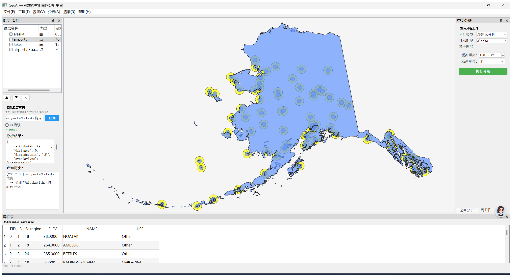
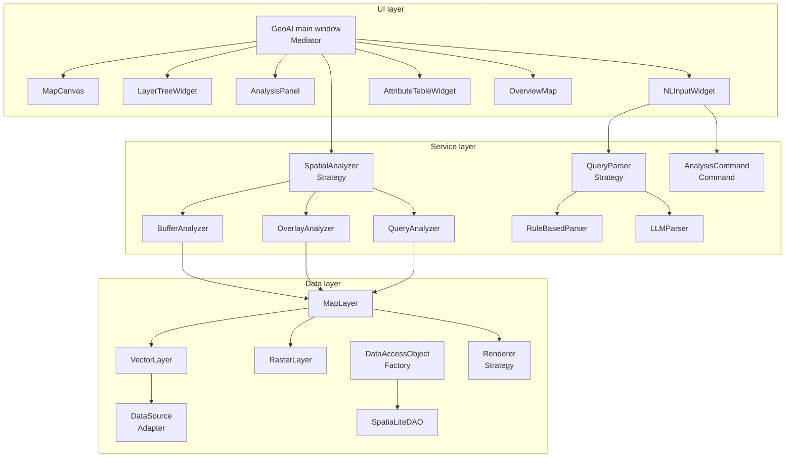

# GeoAI — AI-Enhanced Spatial Analysis Platform

A desktop GIS prototype in **C++17 / Qt 5 / QGIS 3**, built as a four-person
Object-Oriented Programming course project. It combines a QGIS-native map
canvas with vector/raster loading, spatial analysis, SpatiaLite access, and a
natural-language query layer that works either with a deterministic rule parser
or an LLM (DeepSeek API).



*Natural-language query `airports在alaska境内` executed on QGIS sample data:
the result layer is highlighted in yellow, the parsed command is shown in the
left panel, and the attribute table displays the selected source layer.*

## Highlights

- **QGIS-native rendering** — `QgsMapCanvas` with pan, scroll zoom, box zoom,
  full-extent, layer tree and raster/vector symbolization.
- **Dual natural-language pipeline** — a rule-based parser (keywords + regex)
  with an LLM parser as an optional, fallible extension; both produce the same
  `AnalysisCommand` object.
- **OOP-first architecture** — strategy, factory, template method, mediator,
  command, adapter and observer patterns are used across the layers.
- **Parallel buffer analysis** — `QgsGeometry::buffer` over features with
  OpenMP.
- **Multiple data sources** — Shapefile, GeoJSON, GeoPackage, GeoTIFF,
  SpatiaLite, CSV/TSV.

## Features

| Category | Feature |
|----------|---------|
| **Data** | Shapefile, GeoJSON, GeoPackage, GeoTIFF, SpatiaLite, CSV/TSV |
| **Canvas** | QGIS-native `QgsMapCanvas`, pan, scroll-zoom, box-zoom, full extent |
| **Layers** | Tree widget, visibility toggle, ordering, opacity metadata, labels |
| **Attribute** | Table view, field inspector, feature count |
| **Analysis** | Buffer, overlay (intersection/union), attribute query, spatial query |
| **AI** | Rule-based NL parser + DeepSeek LLM integration (optional API key) |
| **Rendering** | Simple, classified and graduated symbols; SLD export |
| **SQL** | Query SpatiaLite databases |
| **Project** | Save/load layer state as JSON |
| **Editing** | Add/delete features on a memory layer |
| **Tools** | WGS84 reprojection, vector clip, CSV import, clear all |
| **Extras** | OpenMP parallel buffer, eagle-eye overview, mouse coordinate display |

## Architecture



The UI talks to the service layer through signals/slots and `AnalysisCommand`
objects; the data layer hides QGIS and database details behind `MapLayer`,
`DataSource`, `Renderer` and `DataAccessObject` abstractions.

## Design patterns

| Pattern | Where it is used |
|---------|------------------|
| **Strategy** | `SpatialAnalyzer` → buffer/overlay/query; `Renderer` → simple/classified/graduated; `QueryParser` → rule/LLM |
| **Factory Method** | `DataAccessObject` creation, layer/data-source creation |
| **Template Method** | `MapLayer::load()` skeleton, with `VectorLayer` / `RasterLayer` hooks |
| **Mediator** | `GeoAI` main window coordinates docks, canvas and services |
| **Command** | `AnalysisCommand` encapsulates a parsed query and serializes to JSON |
| **Adapter** | `DataSource` wraps QGIS data providers and file/database sources |
| **Observer** | Qt signals/slots for layer, canvas, selection and analysis events |

## Natural-language queries

The rule parser recognises Chinese spatial-language patterns, for example:

```text
airports在alaska境内              # spatial: within
查询 lakes 中 AREA_MI 大于 100     # attribute filter
显示与 lakes 相交的 airports       # spatial: intersects
lakes 与 alaska 的交集             # overlay
```

When an API key is entered and **AI增强** is checked, `LLMParser` sends the
query plus the loaded layer names to the DeepSeek chat-completions endpoint and
parses the returned JSON into the same `AnalysisCommand`. If the API call or the
JSON parsing fails, the code falls back to the rule parser. The key is stored
locally through `QSettings`; it is never compiled into the repository.

## Build

Tested on Windows 10/11 with Visual Studio 2022 (v143, C++17), Qt 5.11
(OSGeo4W) and QGIS 3.x development libraries.

### Prerequisites

- Visual Studio 2022 with **Desktop development with C++**
- **Qt VS Tools** with a registered Qt 5 kit
- QGIS development headers and libraries (`qgis_core`, `qgis_gui`) plus GDAL,
  for example an OSGeo4W QGIS dev bundle

### Configure

The project exposes three MSBuild properties:

| Property | Meaning | Example |
|----------|---------|---------|
| `QtInstall` | Qt kit name registered in Qt VS Tools | `osgeo4w-qgis-dev_QT5` |
| `QGIS_PREFIX` | QGIS prefix containing `include/` and `lib/` | `C:\OSGeo4W\apps\qgis-ltr` |
| `QGIS_3RDPARTY` | third-party root containing GDAL headers/libs | `C:\OSGeo4W` |

Open `GeoAI.sln`, select **Release | x64**, and build. If your paths differ
from the defaults, set the properties in **Project → Properties → User Macros**
or pass them on the command line:

```bat
msbuild GeoAI.sln /p:Configuration=Release /p:Platform=x64 ^
  /p:QGIS_PREFIX="C:\OSGeo4W\apps\qgis-ltr" ^
  /p:QGIS_3RDPARTY="C:\OSGeo4W"
```

## Run

`main.cpp` reads `QGIS_PREFIX_PATH` at startup. `run.bat` sets the required
environment variables and launches `x64\Release\GeoAI.exe`:

```bat
set QGIS_DIR=C:\Program Files\QGIS 3.34.1
run.bat
```

For an OSGeo4W-style development bundle where Qt lives outside the QGIS tree:

```bat
set QGIS_DIR=E:\OSGeo4W\apps\qgis-ltr
set QT_DIR=E:\OSGeo4W\apps\Qt5
run.bat
```

`QGIS_DIR`, `QT_DIR`, `QGIS_PREFIX_PATH`, `QT_PLUGIN_PATH`, `GDAL_DATA` and
`PROJ_LIB` can all be overridden from the environment.

## Sample data

- `data/qgis_sample_data/` — QGIS official sample layers (`airports`, `lakes`,
  `alaska`)
- `data/CourseData/table/sample.csv` — CSV import demo
- `SQL/sample_points.geojson`, `sample_lines.geojson`, `sample_polygons.geojson`
  — small vector samples

The 18 MB course GeoTIFF is intentionally excluded from this repository.

## Project structure

```
GeoAI/
├── core/       # MapLayer, DataSource, Renderer, LayerManager, AnalysisCommand
├── analysis/   # SpatialAnalyzer + buffer/overlay/query analyzers
├── SQL/        # DataAccessObject, SpatiaLiteDAO, SpatialQuery, SqlHelper
├── nlp/        # QueryParser, RuleBasedParser, LLMParser
├── ui/         # MapCanvas, layer tree, analysis panel, NL input, attribute table
├── plugin/     # Optional QGIS Python plugin
├── scr/        # Lightweight geometry layer used for interface alignment
├── data/       # Sample datasets
└── docs/       # Screenshots
```

## Team and contributions

| Member | Role | Modules |
|--------|------|---------|
| **闫智昊** | Team lead | Spatial analysis engine, natural-language parsing, LLM integration, geometry algorithms |
| **郭紫晴** | Member | Map visualization, layer/renderer hierarchy, map canvas, eagle-eye overview |
| **王鑫垚** | Member | Data-access layer, SpatiaLite DAO, spatial SQL builder |
| **王凯** | Member | UI integration, main-window mediator, analysis/attribute panels, QGIS plugin |

The full Chinese design document — UML class diagram, sequence diagrams,
module-level design, AI-usage log and contribution breakdown — is in
[`Design.md`](Design.md).

## AI-assisted development

This project was developed with AI assistance for scaffolding, debugging and
documentation. The prompts, affected areas, bug list and code statistics are
recorded in [`Design.md` §7](Design.md) rather than hidden, so the human design
decisions and the generated parts can be reviewed separately.

## Known limitations

- Layer opacity is stored in the project file, but QGIS 3.14 has no per-layer
  opacity API.
- The Qt SQL driver on Windows cannot load the SpatiaLite extension, so some
  spatial SQL functions are unavailable.
- The eagle-eye view is read-only and does not draw a viewport rectangle.
- Buffer distance is interpreted in layer CRS units; geographic layers
  (degrees) need an appropriate distance value.

## 中文简介

GeoAI 是一个基于 C++17、Qt 5 与 QGIS 3 的桌面 GIS 原型，支持多格式矢量/栅格
数据、空间分析、SpatiaLite 查询，以及“规则解析 + 大模型”双通道中文自然语言
查询。项目按 UI、服务、数据三层组织，集中实践了策略、工厂、模板方法、中介者、
命令、适配器和观察者等设计模式。
